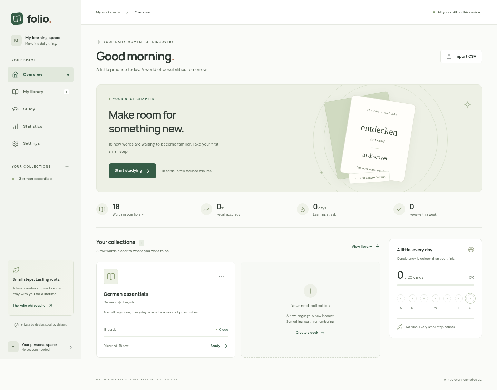

# Folio

**A little practice. A lasting memory.**

Folio is a calm, local-first flashcard app for vocabulary and everything else worth remembering. Import a CSV, build a collection, and study with a transparent spaced-repetition scheduler. No accounts or backend required.



## Start learning

1. Open Folio and choose **Try a sample deck** to explore 18 everyday German words, or **Import your first CSV**.
2. Map your columns, choose the front and back, and preview your cards. Duplicates and missing values are reported before importing.
3. Choose **Start studying**. Think of the answer, reveal it, and rate your recall.
4. Visit **Statistics** to see actual review activity. Set a comfortable daily goal in **Settings**.
5. Export a full JSON backup regularly. Browser data is not automatically synced.

## Features

- Responsive desktop workspace and mobile bottom navigation; intentionally designed light, dark, and system themes.
- Deck creation, descriptions, accents, renaming, duplication, archiving, deletion with confirmation, and merging compatible decks while retaining schedules and history.
- CSV drag-and-drop, worker parsing, delimiter detection (comma, tab, semicolon), UTF-8 validation, column mapping and renaming, optional columns, preview, and duplicate detection.
- Any number of custom card fields, tags, optional examples, grammar, IPA, definitions, notes, memory tricks, and external image URLs.
- Search across all vocabulary fields in the library; paginated card browser, tag/status/difficulty/metadata filters, sorting, selection, and selected-card export.
- Due-first review with a daily new-card limit, new-only, mixed, difficult, typing, and listening practice. Forward, reverse, and mixed directions.
- Independent SM-2-inspired scheduler with Again/Hard/Good/Easy ratings, persisted intervals, ease, lapses, due dates, and review events.
- Device speech synthesis with deck-specific locales, playback rate, optional autoplay, and an explicit unsupported-browser fallback.
- Statistics derived from real reviews: accuracy, study time, streaks, activity heatmap, workload, daily goal, and per-deck progress.
- CSV export, study history export, full JSON backups, and validated merge/replace restoration.
- IndexedDB persistence, offline app shell and locally bundled fonts, installable web manifest, and a production service worker.
- Keyboard shortcuts, native modal focus management, visible focus styles, reduced motion, adjustable text size, and screen-reader labels.

## Development

Requires **Node.js 22.12+** (Node 24 also supported) and npm.

```sh
git clone https://github.com/adelphaeleftheria/my-flash-card.git
cd my-flash-card
npm ci
npm run dev
```

Open the address printed by Vite in a normal local development environment.

```sh
npm run typecheck
npm test                 # scheduler, CSV, statistics, backups
npm run build             # strict TypeScript + Vite + offline cache generation
npm run preview
```

Browser checks use Playwright and an installed Chromium:

```sh
# Linux with /usr/bin/chromium:
npm run test:e2e
npm run test:offline       # builds, then verifies a Pages subpath fully offline

# Another Chromium installation:
CHROMIUM_PATH=/path/to/chrome npm run test:e2e
CHROMIUM_PATH=/path/to/chrome npm run test:offline
```

The browser suite covers importing, duplicate protection, editing, studying, typing, filters, persistence, backup/restore, themes, mobile widths, and automated WCAG checks on representative pages/dialogs. The offline check uses a production build at `/my-flash-card/`, disables networking, reloads, studies, and imports through the cached CSV worker. It is not a substitute for manual screen-reader and device testing.

Use `npm run format` to format source, tests, and configuration.

## GitHub Pages

1. Push this project to the repository's `main` branch.
2. In **Settings → Pages → Build and deployment**, select **GitHub Actions**.
3. The included `.github/workflows/deploy.yml` installs from the lockfile, runs unit tests, builds, uploads `dist`, and deploys it to Pages.
4. Check the deployment URL in the completed action.

Vite uses `base: './'`; all built assets and offline caches are relative to the deployment path. Hash navigation (`#library`, `#study`, etc.) avoids refresh errors on static hosting. You can also serve `dist` from another HTTPS static host. No secrets or server configuration are needed. Deployment itself has not been performed by the local build.

## CSV format

Use a UTF-8 file with a **unique, nonempty header for every column** and at least two columns. A UTF-8 BOM, quoted newlines, umlauts, accents, and non-Latin text are supported. All rows must have the same number of cells as the header. Excel users should choose “CSV UTF-8.”

```csv
German,English,Gender,Plural,Example Sentence,Example Translation,IPA,Tags,Memory trick
Haus,house,das,Häuser,"Das Haus ist groß.",The house is big.,haʊ̯s,A1; Home,Think of home
laufen,to run,,,"Ich laufe jeden Morgen.",I run every morning.,ˈlaʊ̯fn̩,A1; Exercise,
```

A downloadable template is available in the importer and [public/example.csv](public/example.csv). Choose any two imported fields as front and back. Rename or exclude other columns; all included custom fields survive CSV and JSON exports. Import into an existing deck from its options; map the columns to that deck's existing front/back names.

Cards with an empty front or back are counted and skipped explicitly. Possible duplicates use the normalized, case-insensitive front/back pair; the default is to skip them and preserve existing review history. “Import anyway” keeps duplicates as separate cards. Empty rows are counted. Files with duplicate headers, broken quotes, or uneven columns must be corrected before import. The limit is **10 MB per CSV**. Language names in common column headers provide initial speech locales; confirm or change these in deck settings. The importer requires headers rather than guessing vocabulary rows as field names.

## How scheduling works

The scheduler is deliberately understandable, not a claim of perfect learning science:

- **Again:** retry after one minute, lower ease, record a lapse.
- **Hard:** ten minutes initially; later grow the previous interval by 1.2× and lower ease.
- **Good:** one day initially; later multiply by ease (initially 2.5).
- **Easy:** four days initially; later multiply by ease × 1.3 and increase ease.

Ease never drops below 1.3. Learning intervals are stored as fractional days. A review session takes due cards first, then new cards up to the daily limit. Again cards become due for a subsequent session; they are not silently rerated in the same queue. Extra-practice modes use the same scheduler and update real progress. Skip leaves the schedule unchanged. A session saves each completed rating before advancing.

“Learned” means a card has entered the review state, not that recall has been independently proven. Accuracy is the fraction of ratings other than Again. Statistics use local calendar days; time counts active card response time capped at ten minutes per review. Review counts and unique cards studied are intentionally different.

## Data and privacy

Decks, cards, preferences, and review events are stored in IndexedDB in this browser profile. No analytics, login, cloud sync, or vocabulary API exists. Imported content is rendered as text, not HTML. External images are optional HTTPS/HTTP URLs and can contact the host when shown. Speech voices are supplied by the browser/OS; some voices may require networking. Fonts and app assets are bundled locally.

After the first successful production load and service-worker installation, the complete application shell, fonts, and CSV worker are cached. Previously stored decks and reviews remain usable offline. External images and some speech voices cannot be guaranteed offline. Offline caching requires HTTPS or localhost and is enabled only for production builds. Browser support and installation UI vary; the app always works as a regular website.

Browser storage can be cleared or evicted. Private browsing may restrict persistence. Storage failures appear as a visible warning with access to backup settings. Wait until saving finishes before closing the app. Do not edit the same data in multiple tabs: cross-tab synchronization is not implemented in this release.

## Backup and restore

**Settings → Export full backup** downloads `flashcards-backup-YYYY-MM-DD.json`, including all vocabulary, custom fields, schedules, review history, and preferences. Store this file somewhere safe.

**Restore backup** validates the file and asks you to choose:

- **Merge:** retain current data, add unknown item IDs, and keep the current version of matching items and preferences.
- **Replace:** replace the entire current local dataset, including preferences.

Export a backup before replacing or clearing data. CSV is useful for vocabulary exchange but is **not** a complete backup: it does not contain review history, deck membership, or schedules. Exporting all cards creates a union of custom columns across decks; use JSON to preserve the exact library structure.

## Architecture

```text
src/components/       Workspace, library, study, import, editing, statistics, settings
src/lib/model.ts      Deck/card/review/settings types and constructors
src/lib/storage.ts    IndexedDB persistence boundary
src/lib/sample.ts     German demonstration vocabulary
src/lib/i18n.ts       Initial English/German navigation dictionary
src/features/         Scheduler, CSV worker, statistics, backup, pronunciation
src/styles/           Responsive design tokens and component styles
scripts/              Production offline-cache generation
tests/                Logic, browser and production-offline checks
```

React state owns the current dataset, while storage is isolated behind a small asynchronous interface. Reviews are append-only events and charts are derived from them. The scheduler has no UI or storage dependency. The persistence interface can be replaced with incremental record stores or optional synchronization later.

## Browser support and limitations

Target current Chrome, Edge, Firefox, and Safari with IndexedDB. Speech synthesis availability, voice quality, PWA installation, storage limits, and offline behavior vary by device. Test playback on the actual device; no prerecorded audio is included.

This release prioritizes the complete import → study → review → backup loop. It does not implement cloud sync, accounts, AI integrations, image attachments, audio-file importing, automatic translation, editable keyboard bindings, fuzzy search, swipes, or auto-advance. Image URLs are supported. Search is a case-insensitive substring search. Deck-level settings cover name, description, field names, locales, archive, and accent; study modes/direction are session choices. German translation currently covers navigation only; a full UI translation remains future work. Font size and reduced motion are supported; compact mode is not.

CSV parsing runs in a worker and card lists render 50 items per page. The current persistence layer stores one versioned dataset per save, and derived statistics scan in-memory reviews. This is appropriate for small and medium personal libraries; **50,000-card interactive performance has not been established**. Incremental IndexedDB records, indexed search, and cached aggregations should precede claiming large-library support. Backups are limited to 100 MB and validated for referential integrity; they are local files and should be kept private.

Future work: incremental persistence, cross-tab coordination, complete localization, richer card filtering, configurable shortcuts, and optional sync behind an explicit user choice.
